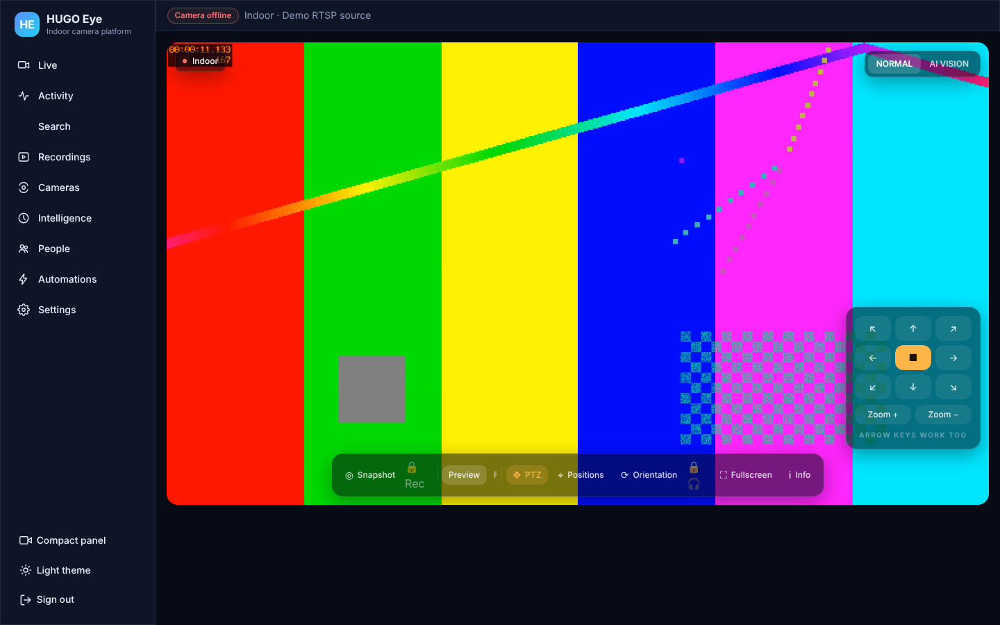
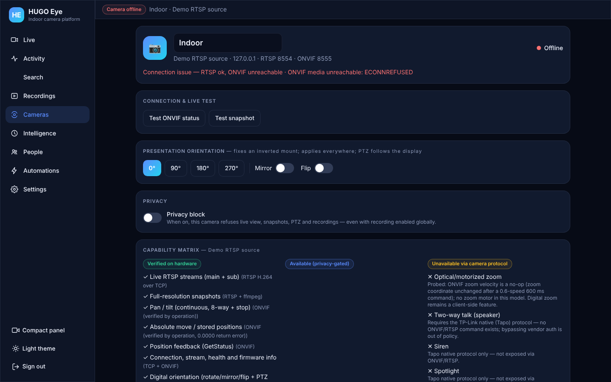
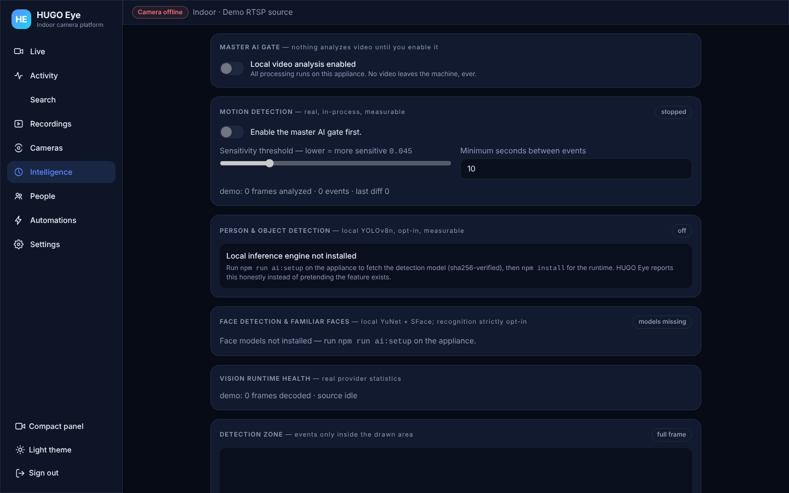
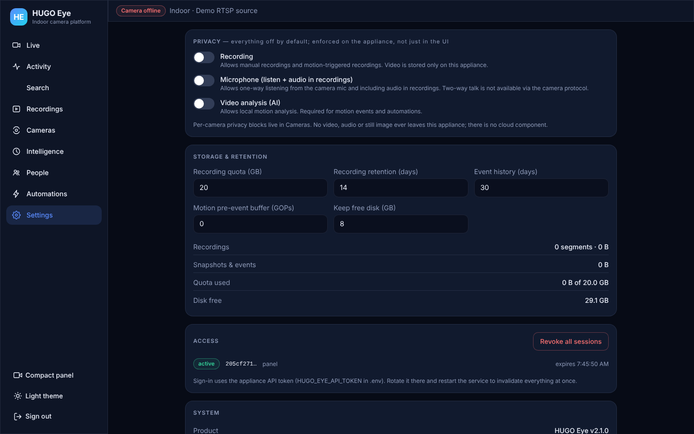

# HUGO Eye

[](https://github.com/IamRedi/hugo-eye-showcase/actions/workflows/ci.yml)

**A local camera platform for the home, with no cloud.** HUGO Eye runs on a small Ubuntu machine on the home network, pulls video straight from the camera over RTSP/ONVIF, detects motion, people and objects locally, records crash-safely and shows everything in a web panel. Video, recordings and AI analysis never leave the machine.

HUGO Eye is the first device of the HUGO family with a finished interface to [HUGO Core](https://github.com/IamRedi/hugo-core-showcase), the author's personal AI core. What is proven about that and what is not is listed under [Role in the HUGO ecosystem](#role-in-the-hugo-ecosystem).

[Deutsche Version](README.md) · [Project status (German)](docs/PROJEKTSTAND.md) · [Evidence log (German)](EVIDENCE.md) · [Security](SECURITY.md)




> **Evidence and limitations:** This public snapshot was tested using test media, without a connected physical camera. Operation on the author's private mini PC with a real camera is documented in the author's records, not independently reverified by the public-snapshot tests. [Verification record (German)](EVIDENCE.md).

## At a glance

| | |
|---|---|
| **What** | Camera server and web panel: live view, recordings, events, search, people, automations, PTZ |
| **Hardware** | Ubuntu mini PC, TP-Link Tapo C520WS (ONVIF Profile S, RTSP H.264). More cameras via the `CameraDriver` interface |
| **Stack** | Node.js 22 (ESM, no required dependencies), own RTSP client, ffmpeg, SQLite (`node:sqlite`), React 19 + TypeScript + Vite |
| **Local AI** | Motion (frame difference), people/objects (YOLOv8n via onnxruntime), faces (YuNet + SFace), semantic search (CLIP), scene descriptions (Qwen2.5-VL via Ollama). All optional, all off until switched on |
| **Tests** | 96 `node:test` tests including an emulated RTSP camera, all green ([evidence log](EVIDENCE.md)) |
| **Status** | According to the author's records it runs as a service on his mini PC with a real camera. Not a commercial product; owner acceptance is pending ([status](docs/PROJEKTSTAND.md)) |

## What it does

- **One camera session for everyone.** Exactly one RTSP connection per stream (`RelayHub`); live view, recording, motion and AI attach through in-process pipes. A state machine (`idle → connecting → streaming ⇄ recovering`) with a watchdog brings the camera back on its own after outages.
- **Live video in the browser.** H.264 is passed through unchanged as fMP4 (MSE, almost no CPU). If the picture stalls, the player falls back to MJPEG by itself.
- **Recordings that survive a crash.** 60-second segments, cleanly finalized, real timestamps, quota, retention and orphan recovery; optional pre-event buffer.
- **Local detection with honest states.** Every AI provider reports `not_installed`, `inactive`, `starting`, `active` or `error`. Without a model the panel claims no detection.
- **Knowing people, naming them carefully.** Faces are recognized only for profiles you create. The live overlay distinguishes "recognized", "tracked", "possibly" and "unknown" instead of guessing a name.
- **PTZ and auto-follow.** Pan, tilt, stored positions; optionally the camera follows a person (closed-loop visual servoing over ONVIF). Any manual move cancels it at once.
- **Natural-language search.** "someone sitting on the sofa" finds matching event images through CLIP embeddings, with score and a link to the recording.
- **Safe on the home network.** Token login, revocable sessions, short-lived stream grants, same-origin checks, rate limits. Camera passwords never appear in process arguments or logs (unit-tested).

| Cameras and capabilities | Local intelligence | Settings and privacy |
|---|---|---|
|  |  |  |

The screenshots come from the local demo below: an emulated RTSP camera with a test picture and no AI models. That is why the header says "Camera offline" (the demo camera has no ONVIF) and detection honestly reports "not installed".

## Role in the HUGO ecosystem

HUGO is the author's personal AI assistant. [HUGO Core](https://github.com/IamRedi/hugo-core-showcase) owns identity, memory, permissions and capability routing. Devices such as HUGO Eye, [LED Wall](https://github.com/IamRedi/led-wall-showcase) or an ESP32 rover stay independent and offer HUGO a controlled interface only. The rule: **the AI proposes, the device executes deterministically and keeps authority.**

```
HUGO Core ──(DeviceAdapter, authorized by Core)──▶ HUGO Eye API ──▶ RTSP/ONVIF ──▶ camera
```

**In the code and tested:**

- `src/adapter/deviceAdapter.js` implements HUGO Core's provider port (`identity`, `runtimeSnapshot`, `negotiate`, `registerCapabilities`, `execute`, `cancel`); `src/adapter/contracts.js` mirrors HUGO Core's Kotlin invariants (HUGO Core commit `cf03ce5`, task H078 "Portable perception foundation").
- 13 capabilities with risk and safety classes, e.g. `camera.snapshot@1.0`, `camera.ptz_move@1.0` (risk ELEVATED, physical action), `perception.observations@1.0`, `perception.subscribe@1.0`.
- The device never grants itself authority: every request needs an authorization reference from HUGO Core, an exact target and a deadline. Discovery does not mean permission.
- 20 contract tests in `test/adapter-contracts.test.mjs` (capability wire format, request and result envelopes, negotiation, manifests with SHA-256 digest).
- The running app serves the manifest at `/api/adapter/manifest` (checked in the demo).

**Not proven yet:** HUGO Core and HUGO Eye have never been paired live; the interface is deliberately not wired. The first real run (pairing, authorization in Core, snapshot and PTZ through HUGO) is the next HUGO step.

## Try it without a camera

Requirements: Node.js 22.5+, ffmpeg.

```bash
git clone https://github.com/IamRedi/hugo-eye-showcase && cd hugo-eye-showcase
npm run demo
```

Open `http://127.0.0.1:8764/` and sign in with the token `demo-token-demo-token-demo-token`. The demo runs the real application against an emulated RTSP camera (`scripts/demo-camera.mjs`, ffmpeg test picture as H.264). Everything lives in a temporary folder and is removed on Ctrl+C. `npm run demo -- --input clip.mp4` streams your own video instead.

For local detection, `npm run ai:setup` downloads the models (checksums and licenses are pinned in the script) and `npm install onnxruntime-node` adds the runtime.

## Running with a real camera

```bash
cp .env.example .env && chmod 600 .env   # camera account, token, data folder
npm start                                # service, panel on http://127.0.0.1:8764/
npm run selftest                         # checks against the real camera
npm run install:service                  # systemd --user unit
```

The panel ships prebuilt in `ui/dist`. Rebuild with `cd ui && npm ci && npm run build`.

## Tests

```bash
npm test                                 # 96 tests, Node 22, no camera needed
cd ui && npm ci && npm run build         # type check and panel build
```

GitHub Actions runs the tests, the panel build and gitleaks on every push.

## License

Source available for reading and evaluation, not for reuse: see [LICENSE](LICENSE). The AI models are not part of this repository and carry their own licenses (YOLOv8n: AGPL-3.0; YuNet, SFace, CLIP: Apache-2.0/MIT), see `scripts/ai-setup.mjs`.
